

  
<picture><source media="(max-width: 600px)" srcset="assets/v/blank.f5ac3ad7.svg" /><source media="(prefers-color-scheme: dark)" srcset="assets/v/hero-dark.f97168d7.svg" />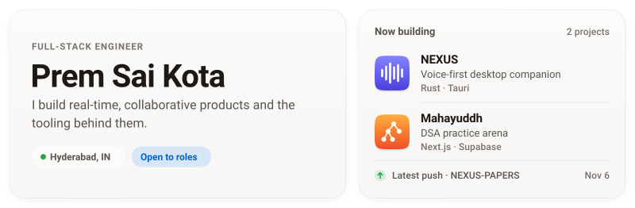</picture><picture><source media="(min-width: 601px)" srcset="assets/v/blank.f5ac3ad7.svg" /><source media="(prefers-color-scheme: dark)" srcset="assets/v/hero-compact-dark.9380294c.svg" />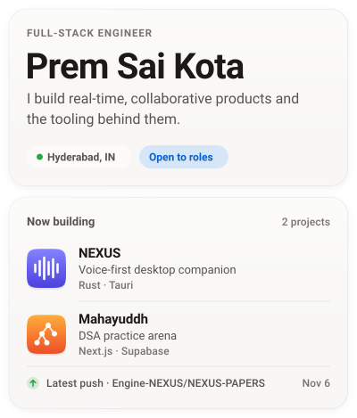</picture>
  
<a href="https://premsai.dev/"><picture><source media="(prefers-color-scheme: dark)" srcset="assets/v/btn-portfolio-dark.cc264bc0.svg" /></picture></a> <a href="https://linkedin.com/in/premsai22k"><picture><source media="(prefers-color-scheme: dark)" srcset="assets/v/btn-linkedin-dark.a717f2e8.svg" /></picture></a> <a href="https://x.com/premsaik22"><picture><source media="(prefers-color-scheme: dark)" srcset="assets/v/btn-x-dark.7a10c967.svg" /></picture></a> <a href="https://www.threads.net/@iblameprems"><picture><source media="(prefers-color-scheme: dark)" srcset="assets/v/btn-threads-dark.298bf5d8.svg" /></picture></a> <a href="mailto:premsai224k@gmail.com"><picture><source media="(prefers-color-scheme: dark)" srcset="assets/v/btn-email-dark.d82f56eb.svg" /></picture></a>
  
<picture><source media="(max-width: 600px)" srcset="assets/v/blank.f5ac3ad7.svg" /><source media="(prefers-color-scheme: dark)" srcset="assets/v/github-year-dark.e841f0d4.svg" />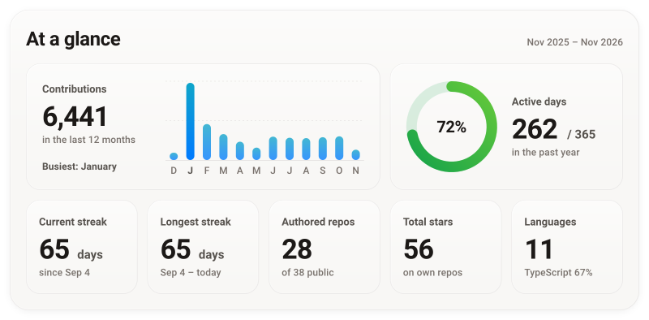</picture><picture><source media="(min-width: 601px)" srcset="assets/v/blank.f5ac3ad7.svg" /><source media="(prefers-color-scheme: dark)" srcset="assets/v/github-year-compact-dark.c877aef9.svg" />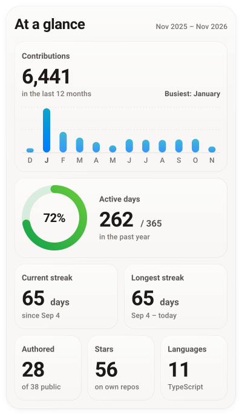</picture>
  
<picture><source media="(max-width: 600px)" srcset="assets/v/blank.f5ac3ad7.svg" /><source media="(prefers-color-scheme: dark)" srcset="assets/v/section-work-dark.ca1d85b5.svg" />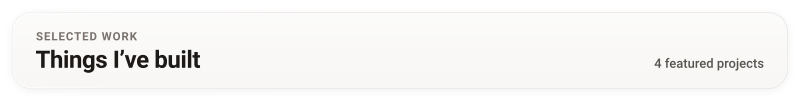</picture><picture><source media="(min-width: 601px)" srcset="assets/v/blank.f5ac3ad7.svg" /><source media="(prefers-color-scheme: dark)" srcset="assets/v/section-work-compact-dark.859d0db2.svg" />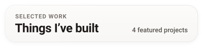</picture>
  
<picture><source media="(max-width: 600px)" srcset="assets/v/blank.f5ac3ad7.svg" /><source media="(prefers-color-scheme: dark)" srcset="assets/v/project-zync-dark.3f98df26.svg" />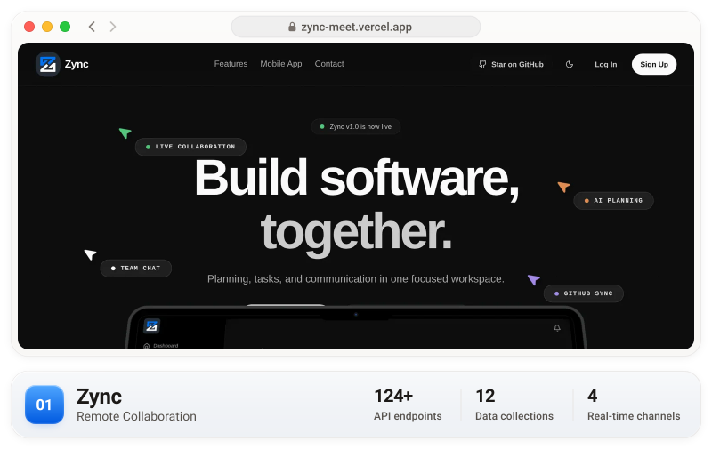</picture><picture><source media="(min-width: 601px)" srcset="assets/v/blank.f5ac3ad7.svg" /><source media="(prefers-color-scheme: dark)" srcset="assets/v/project-zync-compact-dark.39364d10.svg" />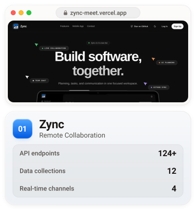</picture>
 
<a href="https://zync-meet.vercel.app"><picture><source media="(prefers-color-scheme: dark)" srcset="assets/v/btn-live-dark.47294805.svg" /></picture></a> <a href="https://github.com/zync-meet/Zync"><picture><source media="(prefers-color-scheme: dark)" srcset="assets/v/btn-source-dark.c55faa17.svg" /></picture></a>
  
<picture><source media="(max-width: 600px)" srcset="assets/v/blank.f5ac3ad7.svg" /><source media="(prefers-color-scheme: dark)" srcset="assets/v/project-mahayuddh-dark.be839322.svg" />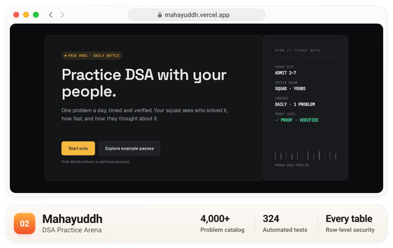</picture><picture><source media="(min-width: 601px)" srcset="assets/v/blank.f5ac3ad7.svg" /><source media="(prefers-color-scheme: dark)" srcset="assets/v/project-mahayuddh-compact-dark.18db3e7b.svg" />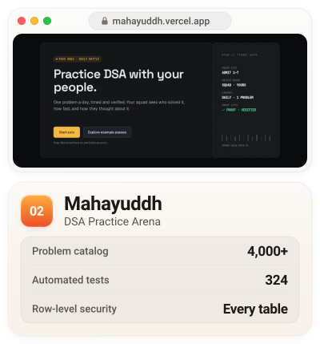</picture>
 
<a href="https://mahayuddh.vercel.app/welcome"><picture><source media="(prefers-color-scheme: dark)" srcset="assets/v/btn-live-dark.47294805.svg" /></picture></a> <a href="https://github.com/prem22k/mahayuddh"><picture><source media="(prefers-color-scheme: dark)" srcset="assets/v/btn-source-dark.c55faa17.svg" /></picture></a>
  
<picture><source media="(max-width: 600px)" srcset="assets/v/blank.f5ac3ad7.svg" /><source media="(prefers-color-scheme: dark)" srcset="assets/v/project-nexus-dark.451d2777.svg" />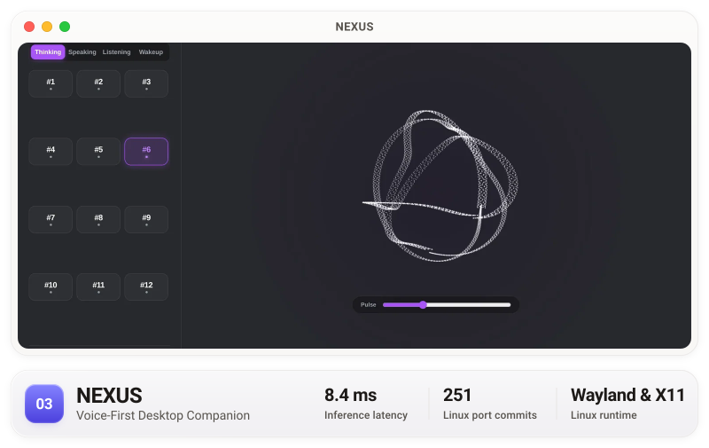</picture><picture><source media="(min-width: 601px)" srcset="assets/v/blank.f5ac3ad7.svg" /><source media="(prefers-color-scheme: dark)" srcset="assets/v/project-nexus-compact-dark.3bf1506d.svg" />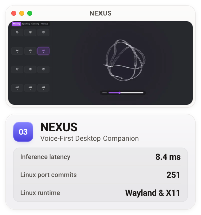</picture>
 
<a href="https://github.com/Engine-NEXUS/linux"><picture><source media="(prefers-color-scheme: dark)" srcset="assets/v/btn-source-dark.c55faa17.svg" /></picture></a>
  
<picture><source media="(max-width: 600px)" srcset="assets/v/blank.f5ac3ad7.svg" /><source media="(prefers-color-scheme: dark)" srcset="assets/v/project-servx-dark.60c7ad48.svg" /></picture><picture><source media="(min-width: 601px)" srcset="assets/v/blank.f5ac3ad7.svg" /><source media="(prefers-color-scheme: dark)" srcset="assets/v/project-servx-compact-dark.12b22d41.svg" />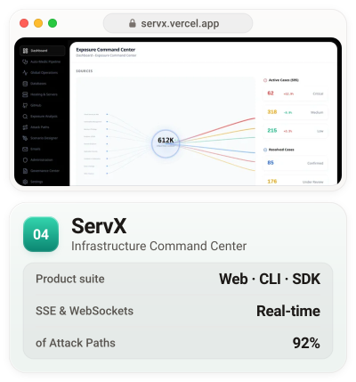</picture>
 
<a href="https://servx.vercel.app"><picture><source media="(prefers-color-scheme: dark)" srcset="assets/v/btn-live-dark.47294805.svg" /></picture></a> <a href="https://github.com/Servx-lab/ServX"><picture><source media="(prefers-color-scheme: dark)" srcset="assets/v/btn-source-dark.c55faa17.svg" /></picture></a>
  
<picture><source media="(max-width: 600px)" srcset="assets/v/blank.f5ac3ad7.svg" /><source media="(prefers-color-scheme: dark)" srcset="assets/v/codebase-dark.56d56d56.svg" />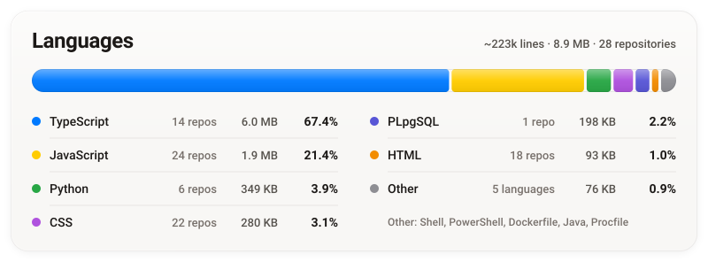</picture><picture><source media="(min-width: 601px)" srcset="assets/v/blank.f5ac3ad7.svg" /><source media="(prefers-color-scheme: dark)" srcset="assets/v/codebase-compact-dark.2147728b.svg" />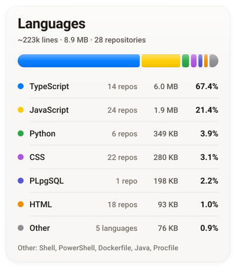</picture>
  
<picture><source media="(max-width: 600px)" srcset="assets/v/blank.f5ac3ad7.svg" /><source media="(prefers-color-scheme: dark)" srcset="assets/v/stack-dark.52255f95.svg" />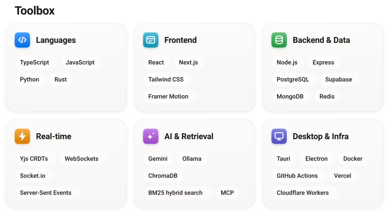</picture><picture><source media="(min-width: 601px)" srcset="assets/v/blank.f5ac3ad7.svg" /><source media="(prefers-color-scheme: dark)" srcset="assets/v/stack-compact-dark.7778cab4.svg" /></picture>
  
<picture><source media="(max-width: 600px)" srcset="assets/v/blank.f5ac3ad7.svg" /><source media="(prefers-color-scheme: dark)" srcset="assets/v/activity-dark.7d91aa9a.svg" />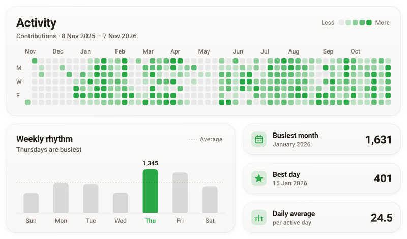</picture><picture><source media="(min-width: 601px)" srcset="assets/v/blank.f5ac3ad7.svg" /><source media="(prefers-color-scheme: dark)" srcset="assets/v/activity-compact-dark.c5a681ea.svg" />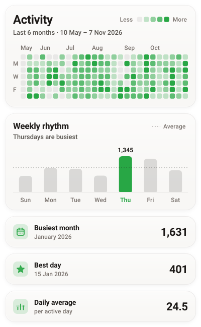</picture>
  
<picture><source media="(max-width: 600px)" srcset="assets/v/blank.f5ac3ad7.svg" /><source media="(prefers-color-scheme: dark)" srcset="assets/v/timeline-dark.7904c0aa.svg" />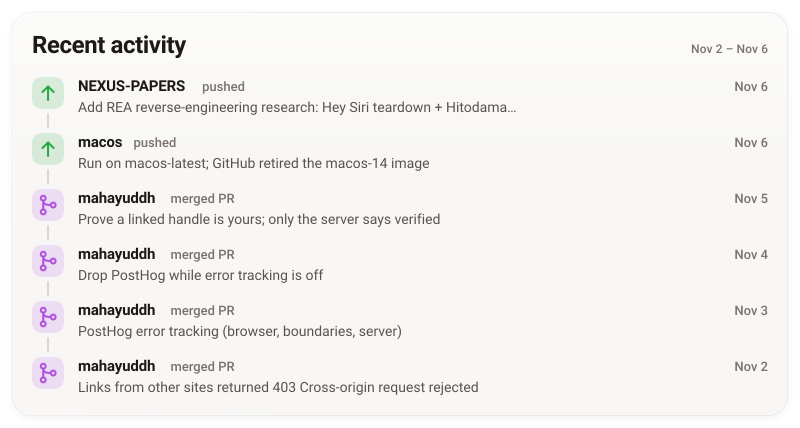</picture><picture><source media="(min-width: 601px)" srcset="assets/v/blank.f5ac3ad7.svg" /><source media="(prefers-color-scheme: dark)" srcset="assets/v/timeline-compact-dark.a72685fb.svg" />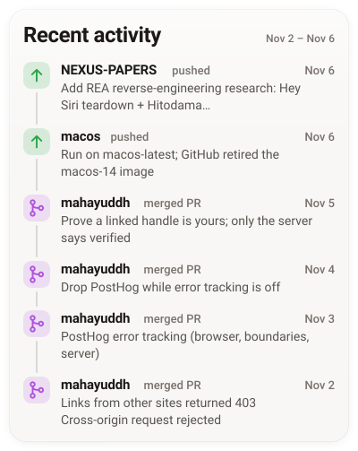</picture>
  
<picture><source media="(max-width: 600px)" srcset="assets/v/blank.f5ac3ad7.svg" /><source media="(prefers-color-scheme: dark)" srcset="assets/v/journey-dark.94709402.svg" />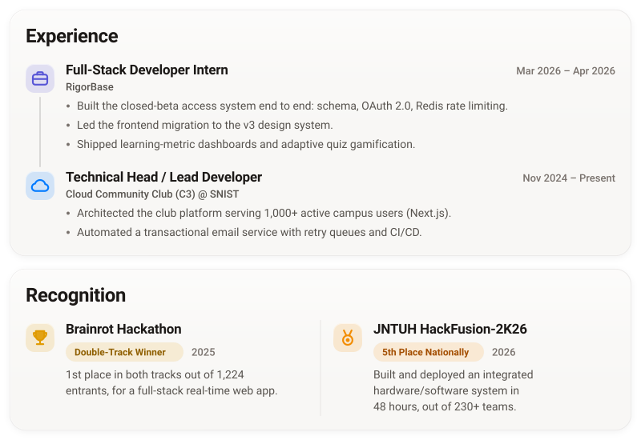</picture><picture><source media="(min-width: 601px)" srcset="assets/v/blank.f5ac3ad7.svg" /><source media="(prefers-color-scheme: dark)" srcset="assets/v/journey-compact-dark.d1b47d1d.svg" />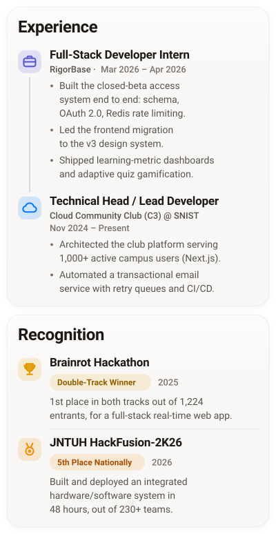</picture>

