

 
<picture><source media="(max-width: 600px)" srcset="assets/v/blank.f5ac3ad7.svg" /><source media="(prefers-color-scheme: dark)" srcset="assets/v/hero-dark.0ad507ef.svg" /></picture><picture><source media="(min-width: 601px)" srcset="assets/v/blank.f5ac3ad7.svg" /><source media="(prefers-color-scheme: dark)" srcset="assets/v/hero-compact-dark.92d9d596.svg" />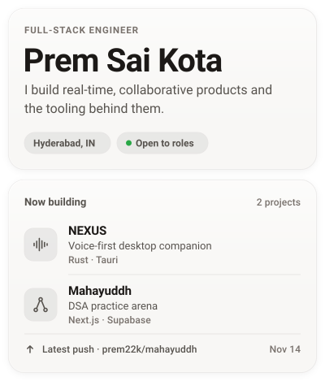</picture>
 
<a href="https://premsai.dev/"><picture><source media="(prefers-color-scheme: dark)" srcset="assets/v/btn-portfolio-dark.51f27635.svg" /></picture></a><a href="https://linkedin.com/in/premsai22k"><picture><source media="(prefers-color-scheme: dark)" srcset="assets/v/btn-linkedin-dark.b136e678.svg" /></picture></a><a href="https://x.com/premsaik22"><picture><source media="(prefers-color-scheme: dark)" srcset="assets/v/btn-x-dark.8c6c5b74.svg" /></picture></a><a href="https://www.threads.net/@iblameprems"><picture><source media="(prefers-color-scheme: dark)" srcset="assets/v/btn-threads-dark.abe9ed04.svg" /></picture></a><a href="mailto:premsai224k@gmail.com"><picture><source media="(prefers-color-scheme: dark)" srcset="assets/v/btn-email-dark.a02ee07f.svg" /></picture></a>
 
<picture><source media="(max-width: 600px)" srcset="assets/v/blank.f5ac3ad7.svg" /><source media="(prefers-color-scheme: dark)" srcset="assets/v/github-year-dark.0a960cb8.svg" />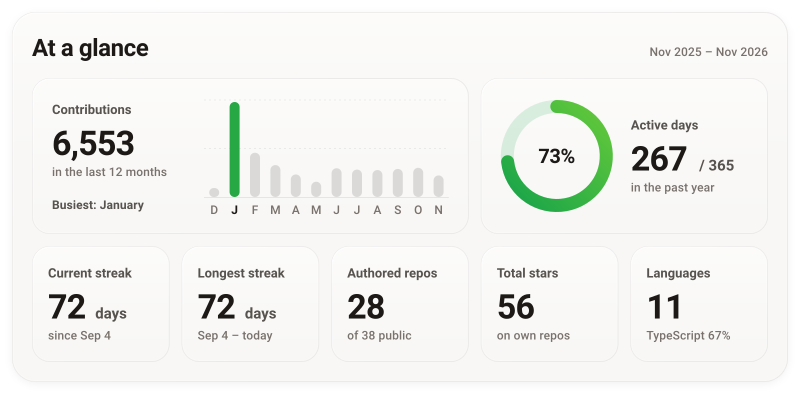</picture><picture><source media="(min-width: 601px)" srcset="assets/v/blank.f5ac3ad7.svg" /><source media="(prefers-color-scheme: dark)" srcset="assets/v/github-year-compact-dark.4ec2c7ae.svg" />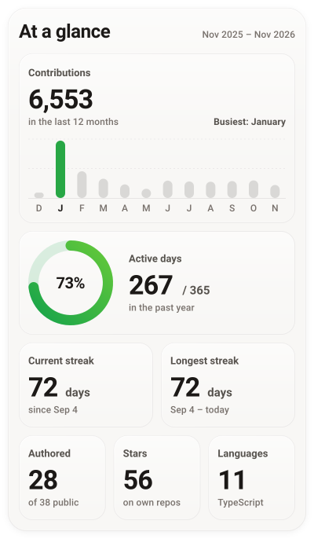</picture>
 
<picture><source media="(max-width: 600px)" srcset="assets/v/blank.f5ac3ad7.svg" /><source media="(prefers-color-scheme: dark)" srcset="assets/v/section-work-dark.ca1d85b5.svg" /></picture><picture><source media="(min-width: 601px)" srcset="assets/v/blank.f5ac3ad7.svg" /><source media="(prefers-color-scheme: dark)" srcset="assets/v/section-work-compact-dark.859d0db2.svg" /></picture>
 
<picture><source media="(max-width: 600px)" srcset="assets/v/blank.f5ac3ad7.svg" /><source media="(prefers-color-scheme: dark)" srcset="assets/v/project-zync-dark.52c5fd18.svg" />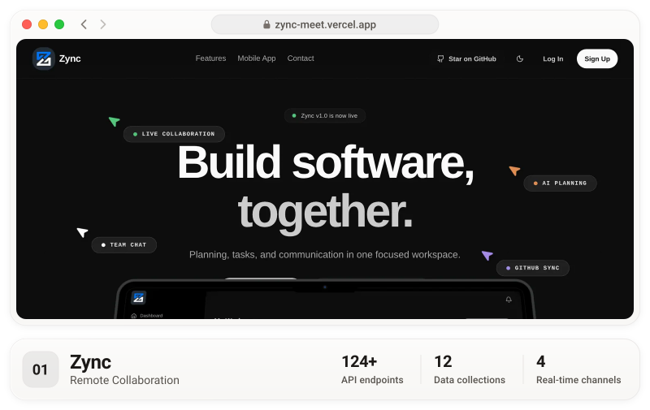</picture><picture><source media="(min-width: 601px)" srcset="assets/v/blank.f5ac3ad7.svg" /><source media="(prefers-color-scheme: dark)" srcset="assets/v/project-zync-compact-dark.642ca495.svg" />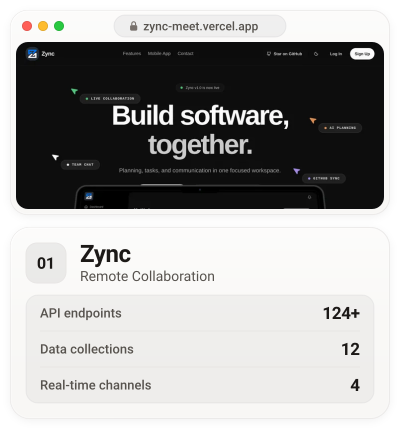</picture>
 
<a href="https://zync-meet.vercel.app"><picture><source media="(prefers-color-scheme: dark)" srcset="assets/v/btn-live-dark.a65882a5.svg" /></picture></a><a href="https://github.com/zync-meet/Zync"><picture><source media="(prefers-color-scheme: dark)" srcset="assets/v/btn-source-dark.ecad8584.svg" /></picture></a>
 
<picture><source media="(max-width: 600px)" srcset="assets/v/blank.f5ac3ad7.svg" /><source media="(prefers-color-scheme: dark)" srcset="assets/v/project-mahayuddh-dark.8b71aa58.svg" />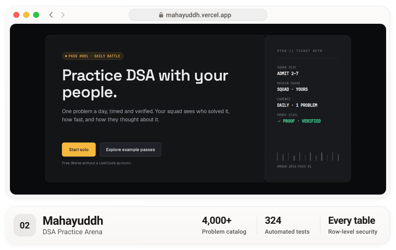</picture><picture><source media="(min-width: 601px)" srcset="assets/v/blank.f5ac3ad7.svg" /><source media="(prefers-color-scheme: dark)" srcset="assets/v/project-mahayuddh-compact-dark.d02c8194.svg" />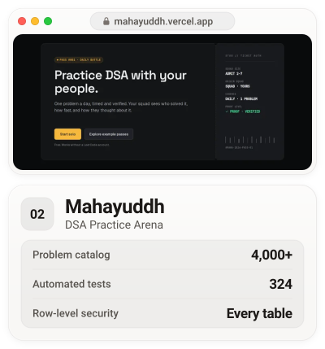</picture>
 
<a href="https://mahayuddh.vercel.app/welcome"><picture><source media="(prefers-color-scheme: dark)" srcset="assets/v/btn-live-dark.a65882a5.svg" /></picture></a><a href="https://github.com/prem22k/mahayuddh"><picture><source media="(prefers-color-scheme: dark)" srcset="assets/v/btn-source-dark.ecad8584.svg" /></picture></a>
 
<picture><source media="(max-width: 600px)" srcset="assets/v/blank.f5ac3ad7.svg" /><source media="(prefers-color-scheme: dark)" srcset="assets/v/project-nexus-dark.e9071481.svg" />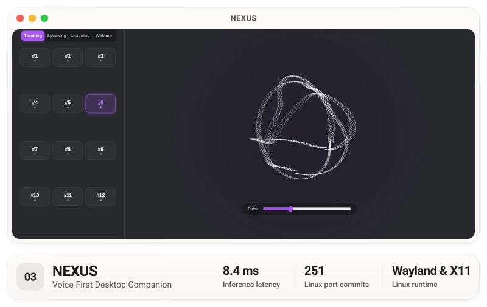</picture><picture><source media="(min-width: 601px)" srcset="assets/v/blank.f5ac3ad7.svg" /><source media="(prefers-color-scheme: dark)" srcset="assets/v/project-nexus-compact-dark.66775438.svg" />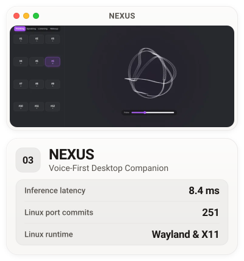</picture>
 
<a href="https://github.com/Engine-NEXUS/linux"><picture><source media="(prefers-color-scheme: dark)" srcset="assets/v/btn-source-dark.ecad8584.svg" /></picture></a>
 
<picture><source media="(max-width: 600px)" srcset="assets/v/blank.f5ac3ad7.svg" /><source media="(prefers-color-scheme: dark)" srcset="assets/v/project-servx-dark.ab4aa735.svg" />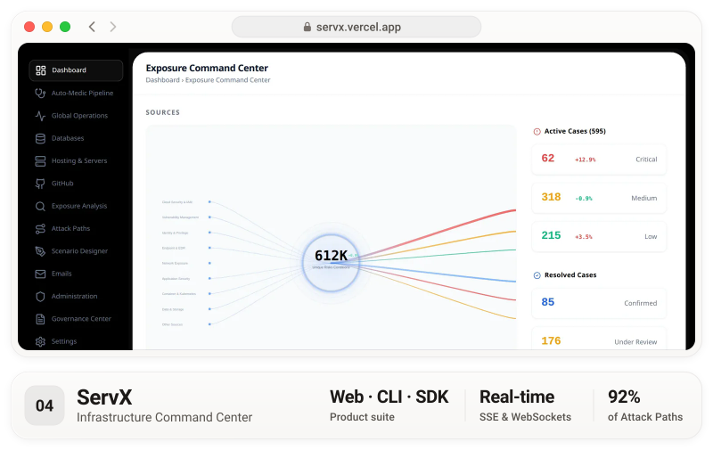</picture><picture><source media="(min-width: 601px)" srcset="assets/v/blank.f5ac3ad7.svg" /><source media="(prefers-color-scheme: dark)" srcset="assets/v/project-servx-compact-dark.5d1de831.svg" />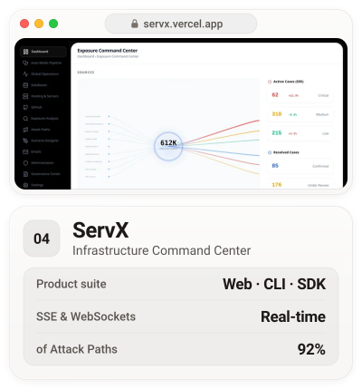</picture>
 
<a href="https://servx.vercel.app"><picture><source media="(prefers-color-scheme: dark)" srcset="assets/v/btn-live-dark.a65882a5.svg" /></picture></a><a href="https://github.com/Servx-lab/ServX"><picture><source media="(prefers-color-scheme: dark)" srcset="assets/v/btn-source-dark.ecad8584.svg" /></picture></a>
 
<picture><source media="(max-width: 600px)" srcset="assets/v/blank.f5ac3ad7.svg" /><source media="(prefers-color-scheme: dark)" srcset="assets/v/codebase-dark.3b78bb44.svg" />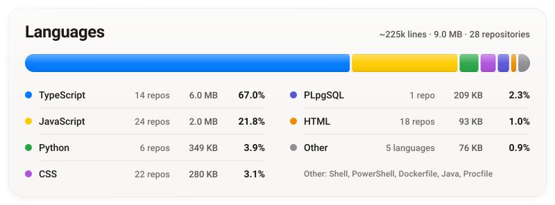</picture><picture><source media="(min-width: 601px)" srcset="assets/v/blank.f5ac3ad7.svg" /><source media="(prefers-color-scheme: dark)" srcset="assets/v/codebase-compact-dark.260e2759.svg" />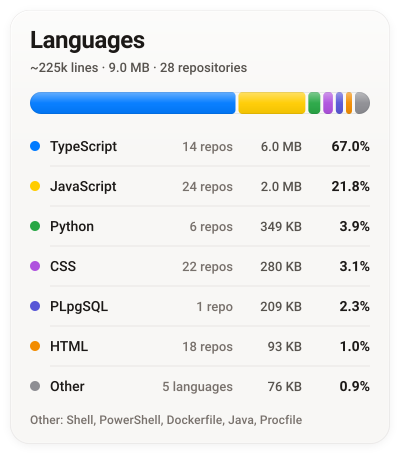</picture>
 
<picture><source media="(max-width: 600px)" srcset="assets/v/blank.f5ac3ad7.svg" /><source media="(prefers-color-scheme: dark)" srcset="assets/v/stack-dark.6fd7cd5d.svg" />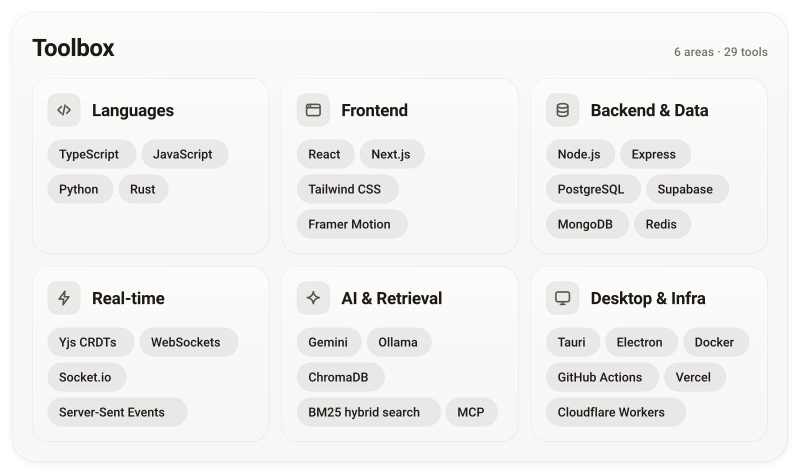</picture><picture><source media="(min-width: 601px)" srcset="assets/v/blank.f5ac3ad7.svg" /><source media="(prefers-color-scheme: dark)" srcset="assets/v/stack-compact-dark.adbd3d52.svg" />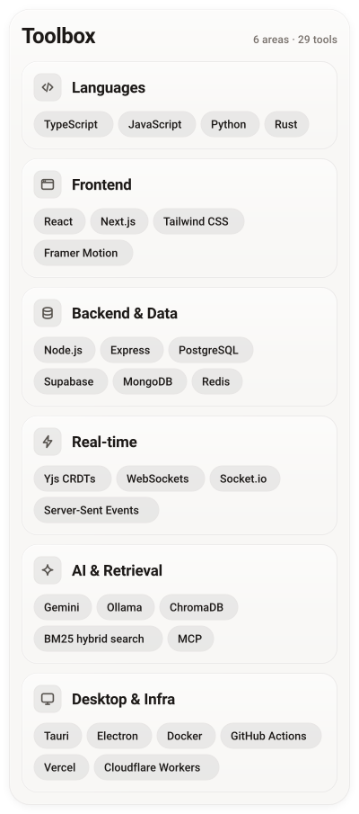</picture>
 
<picture><source media="(max-width: 600px)" srcset="assets/v/blank.f5ac3ad7.svg" /><source media="(prefers-color-scheme: dark)" srcset="assets/v/activity-dark.2771f1d7.svg" />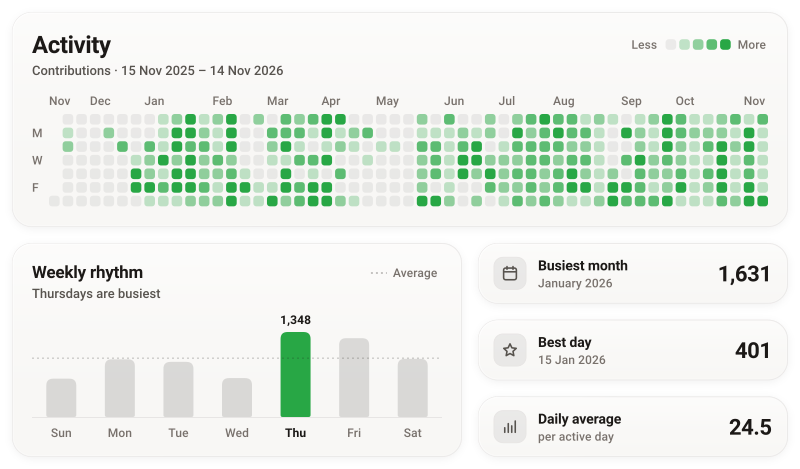</picture><picture><source media="(min-width: 601px)" srcset="assets/v/blank.f5ac3ad7.svg" /><source media="(prefers-color-scheme: dark)" srcset="assets/v/activity-compact-dark.eb2a299d.svg" />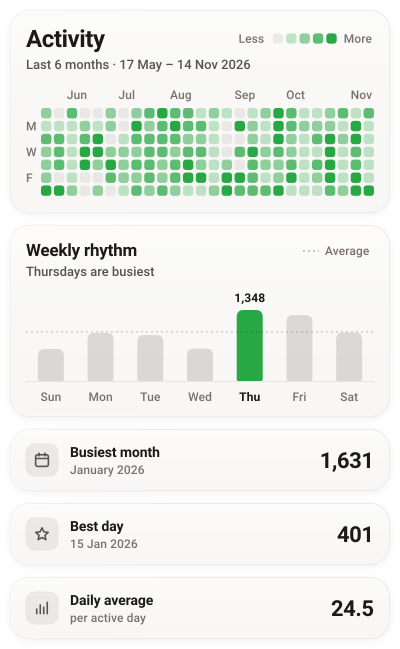</picture>
 
<picture><source media="(max-width: 600px)" srcset="assets/v/blank.f5ac3ad7.svg" /><source media="(prefers-color-scheme: dark)" srcset="assets/v/timeline-dark.a289b770.svg" />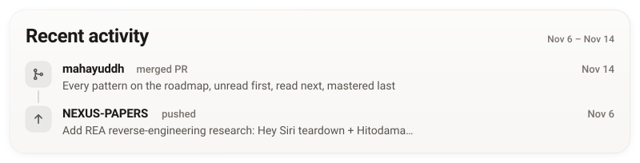</picture><picture><source media="(min-width: 601px)" srcset="assets/v/blank.f5ac3ad7.svg" /><source media="(prefers-color-scheme: dark)" srcset="assets/v/timeline-compact-dark.d34b94dc.svg" />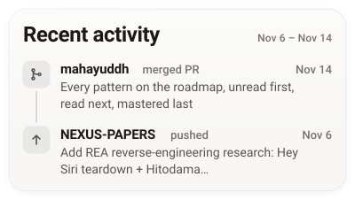</picture>
 
<picture><source media="(max-width: 600px)" srcset="assets/v/blank.f5ac3ad7.svg" /><source media="(prefers-color-scheme: dark)" srcset="assets/v/journey-dark.d227944a.svg" />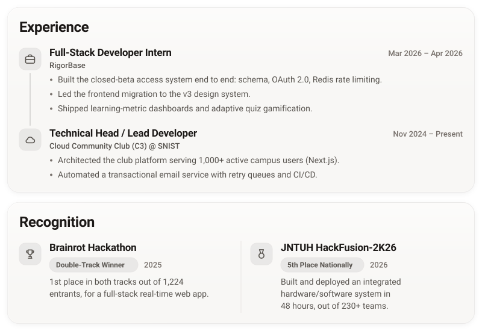</picture><picture><source media="(min-width: 601px)" srcset="assets/v/blank.f5ac3ad7.svg" /><source media="(prefers-color-scheme: dark)" srcset="assets/v/journey-compact-dark.9ae7276a.svg" />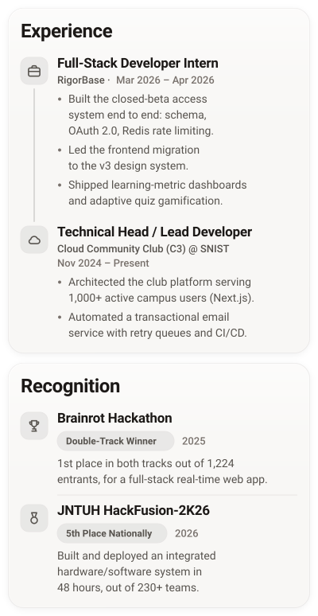</picture>

