

  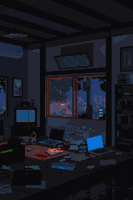

 

<picture><source media="(max-width: 600px)" srcset="assets/blank.svg" /><source media="(prefers-color-scheme: dark)" srcset="assets/hero-dark.svg" />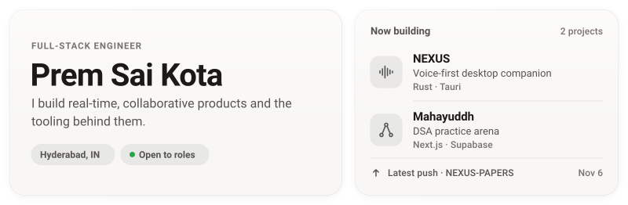</picture><picture><source media="(min-width: 601px)" srcset="assets/blank.svg" /><source media="(prefers-color-scheme: dark)" srcset="assets/hero-compact-dark.svg" /></picture>

  <a href="https://premsai.dev/">Portfolio</a> &nbsp;·&nbsp;
  <a href="https://linkedin.com/in/premsai22k">LinkedIn</a> &nbsp;·&nbsp;
  <a href="https://x.com/premsaik22">X</a> &nbsp;·&nbsp;
  <a href="https://www.threads.net/@iblameprems">Threads</a> &nbsp;·&nbsp;
  <a href="mailto:premsai224k@gmail.com">Email</a>

 

<picture><source media="(max-width: 600px)" srcset="assets/blank.svg" /><source media="(prefers-color-scheme: dark)" srcset="assets/github-year-dark.svg" />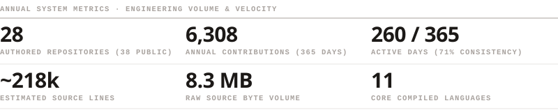</picture><picture><source media="(min-width: 601px)" srcset="assets/blank.svg" /><source media="(prefers-color-scheme: dark)" srcset="assets/github-year-compact-dark.svg" />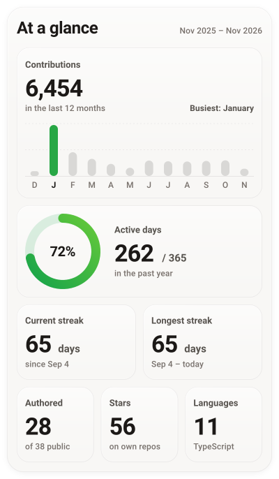</picture>

 

## Selected work

<picture><source media="(max-width: 600px)" srcset="assets/blank.svg" /><source media="(prefers-color-scheme: dark)" srcset="assets/project-zync-dark.svg" /></picture><picture><source media="(min-width: 601px)" srcset="assets/blank.svg" /><source media="(prefers-color-scheme: dark)" srcset="assets/project-zync-compact-dark.svg" />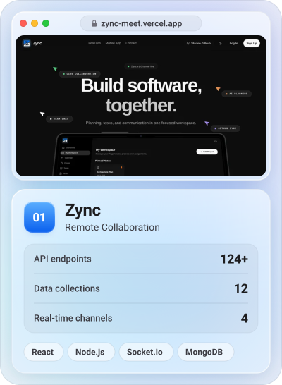</picture>

**Zync**: A collaborative workspace that brings project planning, chat, GitHub activity, notes, tasks and meetings into one place for distributed teams. Notes sync in real time on **Yjs CRDTs**, with offline-friendly IndexedDB persistence.

[Live ↗](https://zync-meet.vercel.app) &nbsp;·&nbsp; [Source ↗](https://github.com/zync-meet/Zync)

 

<picture><source media="(max-width: 600px)" srcset="assets/blank.svg" /><source media="(prefers-color-scheme: dark)" srcset="assets/project-mahayuddh-dark.svg" />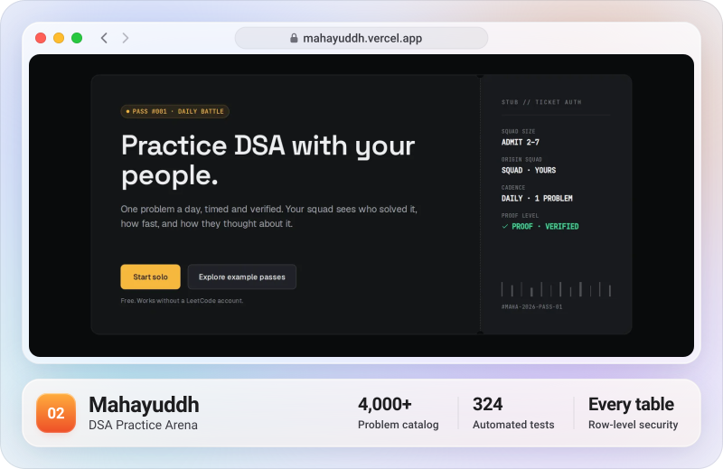</picture><picture><source media="(min-width: 601px)" srcset="assets/blank.svg" /><source media="(prefers-color-scheme: dark)" srcset="assets/project-mahayuddh-compact-dark.svg" />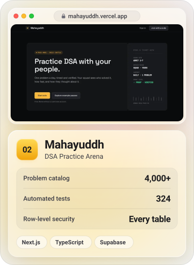</picture>

**Mahayuddh**: A social practice arena for LeetCode: daily timed battles, squad accountability and verified progress. Event-sourced **PostgreSQL** with row-level security on every table, backed by 324 automated tests.

[Live ↗](https://mahayuddh.vercel.app/welcome) &nbsp;·&nbsp; [Source ↗](https://github.com/prem22k/mahayuddh)

 

<picture><source media="(max-width: 600px)" srcset="assets/blank.svg" /><source media="(prefers-color-scheme: dark)" srcset="assets/project-nexus-dark.svg" />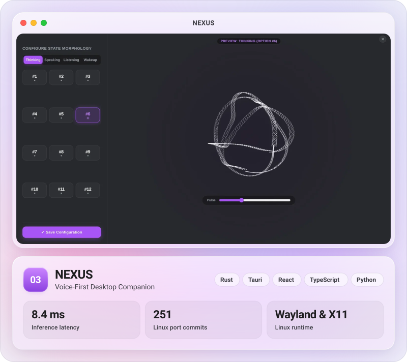</picture><picture><source media="(min-width: 601px)" srcset="assets/blank.svg" /><source media="(prefers-color-scheme: dark)" srcset="assets/project-nexus-compact-dark.svg" />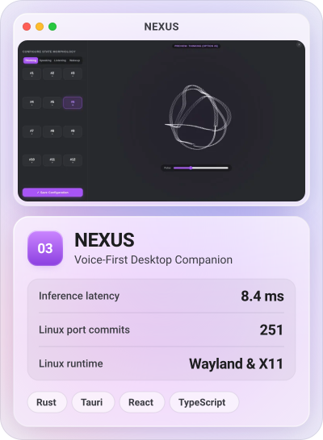</picture>

**NEXUS**: A voice-first desktop companion built in **Rust** and **Tauri** that runs local speech models for code navigation and system automation. I ported the core to Linux (Wayland and X11) and cut wake-word latency from 106 ms to 8.4 ms.

[Source ↗](https://github.com/Engine-NEXUS/linux)

 

<picture><source media="(max-width: 600px)" srcset="assets/blank.svg" /><source media="(prefers-color-scheme: dark)" srcset="assets/project-servx-dark.svg" />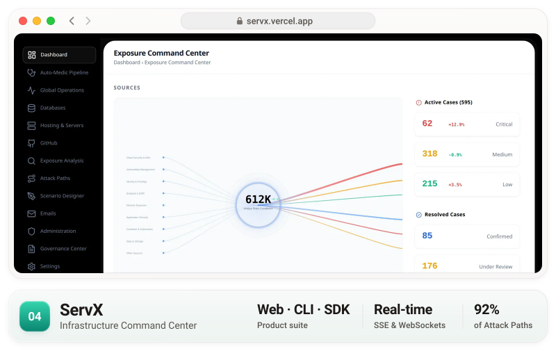</picture><picture><source media="(min-width: 601px)" srcset="assets/blank.svg" /><source media="(prefers-color-scheme: dark)" srcset="assets/project-servx-compact-dark.svg" />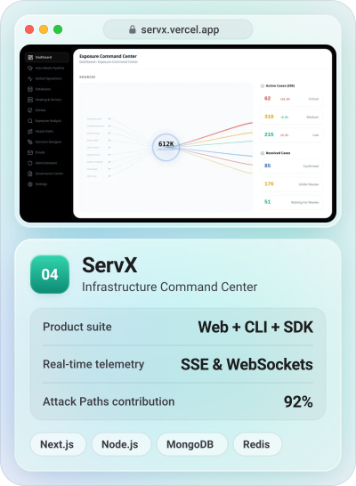</picture>

**ServX**: An infrastructure monitoring and incident-response suite, shipped as a web app, CLI and React SDK, with real-time audit streams over **Server-Sent Events** and WebSockets.

[Live ↗](https://servx.vercel.app) &nbsp;·&nbsp; [Source ↗](https://github.com/Servx-lab/ServX)

 

<picture><source media="(max-width: 600px)" srcset="assets/blank.svg" /><source media="(prefers-color-scheme: dark)" srcset="assets/codebase-dark.svg" />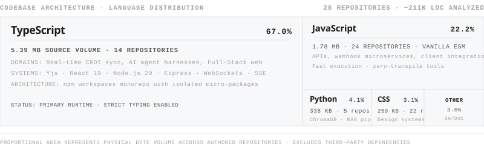</picture><picture><source media="(min-width: 601px)" srcset="assets/blank.svg" /><source media="(prefers-color-scheme: dark)" srcset="assets/codebase-compact-dark.svg" />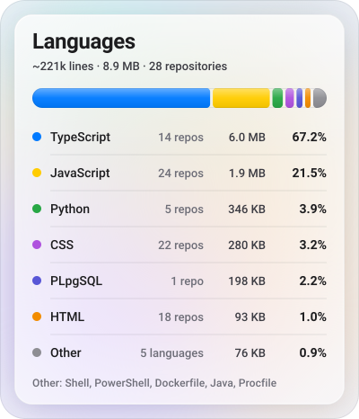</picture>

 

<picture><source media="(max-width: 600px)" srcset="assets/blank.svg" /><source media="(prefers-color-scheme: dark)" srcset="assets/stack-dark.svg" />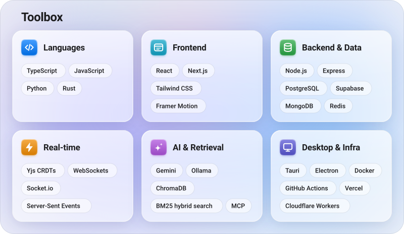</picture><picture><source media="(min-width: 601px)" srcset="assets/blank.svg" /><source media="(prefers-color-scheme: dark)" srcset="assets/stack-compact-dark.svg" />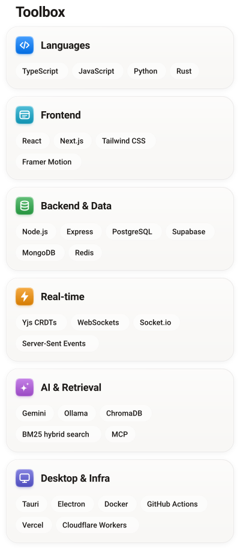</picture>

 

<picture><source media="(max-width: 600px)" srcset="assets/blank.svg" /><source media="(prefers-color-scheme: dark)" srcset="assets/activity-dark.svg" /></picture><picture><source media="(min-width: 601px)" srcset="assets/blank.svg" /><source media="(prefers-color-scheme: dark)" srcset="assets/activity-compact-dark.svg" />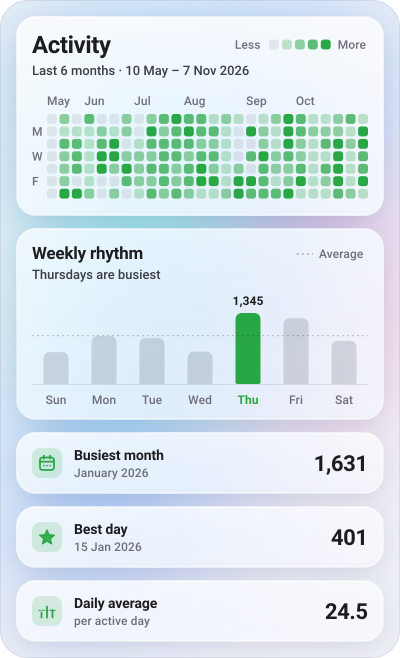</picture>

## Recent activity

| Date | Event | Repository | Context |
| :--- | :--- | :--- | :--- |
| `06 NOV` | `pushed` | [**NEXUS-PAPERS**](https://github.com/Engine-NEXUS/NEXUS-PAPERS) | Add REA reverse-engineering research: Hey Siri teardown + Hitodama compe... |
| `06 NOV` | `pushed` | [**macos**](https://github.com/Engine-NEXUS/macos) | Run on macos-latest; GitHub retired the macos-14 image |
| `05 NOV` | `merged PR` | [**mahayuddh**](https://github.com/prem22k/mahayuddh) | Prove a linked handle is yours; only the server says verified |
| `04 NOV` | `merged PR` | [**mahayuddh**](https://github.com/prem22k/mahayuddh) | Drop PostHog while error tracking is off |
| `03 NOV` | `merged PR` | [**mahayuddh**](https://github.com/prem22k/mahayuddh) | PostHog error tracking (browser, boundaries, server) |
| `02 NOV` | `merged PR` | [**mahayuddh**](https://github.com/prem22k/mahayuddh) | Links from other sites returned 403 Cross-origin request rejected |

## Experience

**RigorBase**, Full-Stack Developer Intern &nbsp;·&nbsp; *Mar 2026 – Apr 2026*
- Built the closed-beta access system end to end: schema design, OAuth 2.0 and Redis rate limiting.
- Led the frontend migration to the v3 design system, improving developer experience and UI consistency across teams.
- Shipped interactive learning-metric dashboards and adaptive quiz gamification.

**Cloud Community Club (C³) @ SNIST**, Technical Head / Lead Developer &nbsp;·&nbsp; *Nov 2024 – Present*
- Architected the official club platform serving 1,000+ active campus users ([Next.js](https://nextjs.org)).
- Automated a transactional email notification service with retry queues and CI/CD pipelines.

## Recognition

- **Brainrot Hackathon**, Double-Track Winner *(2025)*: 1st place in both competitive tracks for a full-stack real-time web app, out of 1,224 entrants.
- **JNTUH HackFusion-2K26**, 5th Place Nationally *(2026)*: built and deployed an integrated hardware/software system in 48 hours, out of 230+ national teams.
